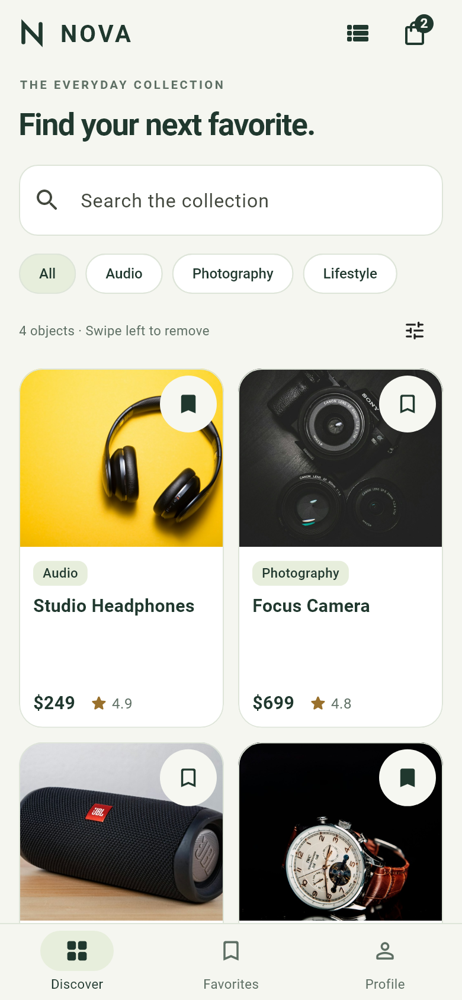
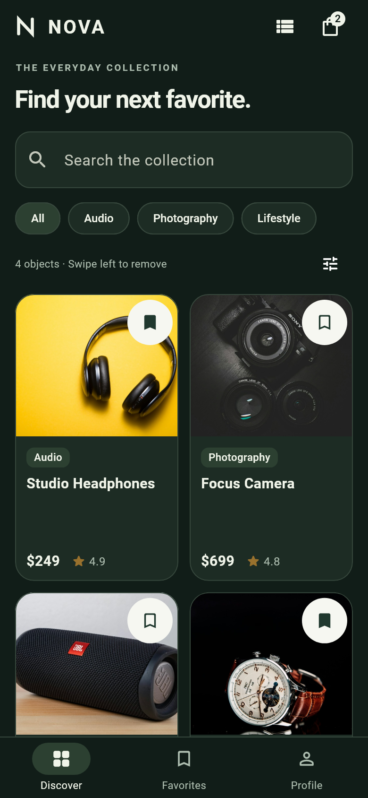

<div align="center">


# NOVA

### Everyday, elevated.

Минималистичный магазин техники на Flutter · Каталог, навигация и жесты

[Код каталога](lib/screens/feed_screen.dart) · [Все пункты задания](docs/CATALOG_ASSIGNMENT.md) · [Сценарий защиты](docs/DEFENSE.md)

</div>

---

NOVA помогает выбрать товар, изучить характеристики, сохранить избранное и оформить демо-заказ. Тёплые нейтральные оттенки, зелёные акценты, крупная типографика и плавные анимации объединяют все экраны. Приложение работает с локальными данными и не требует API-ключей.

## Интерфейс

| Режим списка | Сетка в две колонки | Тёмная тема |
| :---: | :---: | :---: |
|  |  |  |

| Избранное | Корзина | Регистрация |
| :---: | :---: | :---: |
|  |  |  |

Все изображения находятся в [Screenshots](Screenshots). Файлы `emulator-catalog-*` сняты в текущем Android-приложении. Другие `emulator-*` включают исторические снимки предыдущей сдачи. Остальные изображения — реальные Flutter-рендеры тестовых состояний, включая увеличенный текст и широкий экран.

## Видео демонстрации

**[Открыть запись каталога и жестов — MP4](Demo/catalog-gestures.mp4)**

Список → pull-to-refresh → удаление → UNDO → сетка → список → пустой каталог.

Запись сделана на Android-эмуляторе, разрешение 720 × 1600. Если GitHub не показывает встроенный проигрыватель, скачайте файл через **View raw / Download**. [Предыдущее видео Labs 5–7](Demo/nova-walkthrough.mp4) сохранено отдельно: в нём прежний дизайн и фотографии.

## Выполнение заданий

Текущее задание — **каталог с жестами**:

| Критерий | Реализация |
| --- | --- |
| ListView.separated и GridView.builder — 3 балла | Ленивый список с разделителями, сетка строго из двух колонок, адаптивный childAspectRatio, переключатель в AppBar |
| RefreshIndicator | Pull-to-refresh в обоих режимах и пустом состоянии, задержка 1500 мс, сортировка существующих товаров от новых к старым без добавления товаров (изменено по запросу), setState |
| Dismissible и UNDO — 3 балла | ValueKey(product.id), свайп справа налево, красный фон с Icons.delete, SnackBar с UNDO, возврат по исходному индексу |
| Архитектура и защита — 2 балла | Папки models, widgets, screens, отдельно data/state/core; сценарий демонстрации и вопросы в docs/DEFENSE.md |
| Empty State | Иконка, точный заголовок «Catalog is Empty», кнопка Restore catalog для возврата seed-данных |

Подробные ссылки на код и проверки: **[чек-лист задания](docs/CATALOG_ASSIGNMENT.md)**. Фактический ответ преподавателю нужно дать лично на защите.

Предыдущие лабораторные сохранены:

| Задание | Требование | Реализация |
| --- | --- | --- |
| **Lab 5** | Обложка с наложением | `Stack`: изображение товара, категория и bookmark |
| | Компоновка | `Row` для цены и рейтинга, `Wrap` для тегов и вариантов |
| | Закреплённая кнопка | Нижняя панель с `SafeArea` и кнопкой Add to Cart через `Expanded` |
| | Адаптивность | Прокрутка, перенос элементов, широкая и узкая компоновка |
| **Lab 6** | Регистрация | `Form`, `GlobalKey<FormState>`, `TextFormField`, `TextEditingController` |
| | Валидация | Имя, email с `@` и `.`, пароль от 6 символов, совпадение паролей |
| | Интерактивные элементы | Обязательное согласие с условиями; выбор роли убран из формы по запросу |
| | Отправка | Проверка при вводе и отправке, ошибки под полями, `SnackBar`, debug-лог без пароля |
| **Lab 7** | Три вкладки | `BottomNavigationBar`: Discover (Feed), Favorites, Profile |
| | Каталог | Четыре товара с изображениями, названиями и ценами |
| | Передача данных | `Navigator.push` передаёт полный объект `Product` в `DetailScreen` |
| | Возврат | `Navigator.pop` через AppBar и кнопку внутри страницы |
| | Сохранение состояния | Общий `AppStore` и `IndexedStack`; избранное и корзина сохраняются локально |

В соответствии с новым заданием приложение разделено по папкам. **[lib/main.dart](lib/main.dart)** теперь содержит только запуск и инициализацию хранилища; каталог расположен в **[lib/screens/feed_screen.dart](lib/screens/feed_screen.dart)**.

## Возможности

- Онбординг из трёх экранов, поиск, категории, сортировка и переключение List/Grid.
- Обновление жестом, новые поступления, удаление с отменой и восстановление каталога.
- Выбор варианта и количества, ограничения остатков, точный расчёт суммы в целых центах.
- Корзина, демо-оформление заказа, чек и история заказов.
- Локальный профиль, сохранение избранного, корзины, заказов и темы через `shared_preferences`.
- Светлая, тёмная и системная темы.
- `Hero`-переходы, появление экранов, анимации bookmark и кнопок, тактильный отклик.
- Поддержка системной настройки уменьшения анимаций и увеличенного текста.

Это учебный офлайн-MVP: регистрация не создаёт аккаунт на сервере, пароль не сохраняется и не выводится в лог. Оформление заказа не списывает деньги и не создаёт реальную доставку. Характеристики, рейтинг и остатки — демонстрационные данные.

## Запуск

Проверенная среда: **Flutter 3.47.6 / Dart 3.13.5**, Windows и Android SDK. Ограничение Dart указано в `pubspec.yaml`.

```bash
git clone https://github.com/Makhkam11-good/LAB7.git
cd LAB7
flutter pub get
flutter devices
flutter run
```

Перед `flutter run` запустите эмулятор через Android Studio → Device Manager или подключите телефон с USB debugging. Если устройств несколько, используйте `flutter run -d <device-id>`.

На Windows при сообщении о symlink support включите **Developer Mode** и повторите `flutter pub get`.

Для iOS нужны **macOS и Xcode**. iOS-проект и иконки включены, но сборка и подпись iOS на Windows не проверялись.

## Структура проекта

```text
lib/main.dart            Инициализация приложения
lib/app.dart             Тема и корневой экран
lib/models/              Product, варианты, профиль, корзина и заказы
lib/screens/             Каталог, детали, регистрация и остальные экраны
lib/widgets/             Карточки каталога, компоненты и анимации
lib/data/                Seed-данные, генератор поступлений, репозитории
lib/state/               AppStore и сохранение состояния
lib/core/                Тема, форматирование, навигация и валидация
assets/photos/          Фотографии с Unsplash, доступные офлайн
assets/images/          Совместимость с изображениями прежних сохранённых заказов
assets/fonts/           Roboto и лицензия шрифта
test/widget_test.dart   Проверки логики, сценариев и адаптивности
test/catalog_test.dart  Жесты, UNDO, builders, refresh и адаптивная сетка
test/demo_capture_test.dart  Экспорт скриншотов и иконок
Screenshots/            Темы, крупный текст, Android-снимки
Demo/                   Видео переходов между экранами
docs/                   Дизайн-система, ресурсы, защита
android/ · ios/         Мобильные платформенные проекты
```

`PreferencesRepository` хранит данные на устройстве, `MemoryRepository` изолирует тесты. `FeedScreen` обновляет каталог внутри `setState()` и вызывает сохранение через `AppStore`. У List и Grid одна коллекция; состояние сохраняется при переходах между вкладками и после перезапуска. Новые поступления имеют стабильные уникальные ID и работают с избранным, деталями и корзиной.

## Проверка качества

```bash
flutter analyze
flutter test
flutter build apk --debug
```

Для повторного экспорта скриншотов:

```bash
flutter test test/demo_capture_test.dart --dart-define=CAPTURE=true
```

Основной набор содержит **35 тестов**: 18 регрессионных проверок предыдущих лабораторных и 17 проверок каталога. Они охватывают ленивые builders, переключение режимов, задержку 1500 мс, настоящий pull-to-refresh, удаление и UNDO, пустое состояние, уникальность ID, восстановление каталога после запуска и адаптивность. Экспорт скриншотов запускается отдельно с CAPTURE=true.

Проверки адаптивности охватывают 11 экранов при размерах **280×568, 320×568, 390×844, 640×360, 768×1024 и 1440×900**, обычном и удвоенном размере текста. Проверяются также ошибки формы с открытой клавиатурой и закрепление нижней кнопки при прокрутке. В проверенной матрице RenderFlex overflow не обнаружен.

APK после сборки: `build/app/outputs/flutter-apk/app-debug.apk`. Каталог `build/` исключён из Git.

## Материалы для защиты

- [Сценарий выступления на 3–5 минут](docs/DEFENSE.md)
- [Дизайн-система и анимации](docs/DESIGN.md)
- [Источники изображений, иконки и лицензия шрифта](docs/ASSETS.md)
- [Этапы реализации и проверки](docs/PROGRESS.md)

Активный каталог использует фотографии с **Unsplash**, загруженные в проект для работы без интернета. Источники указаны в [docs/ASSETS.md](docs/ASSETS.md). Новые изображения не генерировались. Фотографии иллюстративные, названия, цены и характеристики учебные; связи с изображёнными брендами нет. Монограмма нарисована Flutter Canvas. REST API, серверная авторизация и BLoC — направления следующих этапов Capstone.
