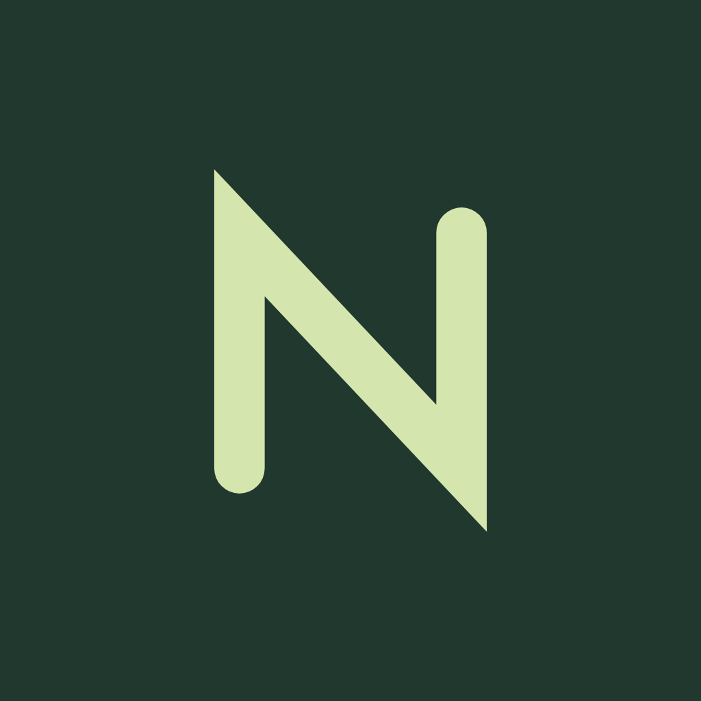
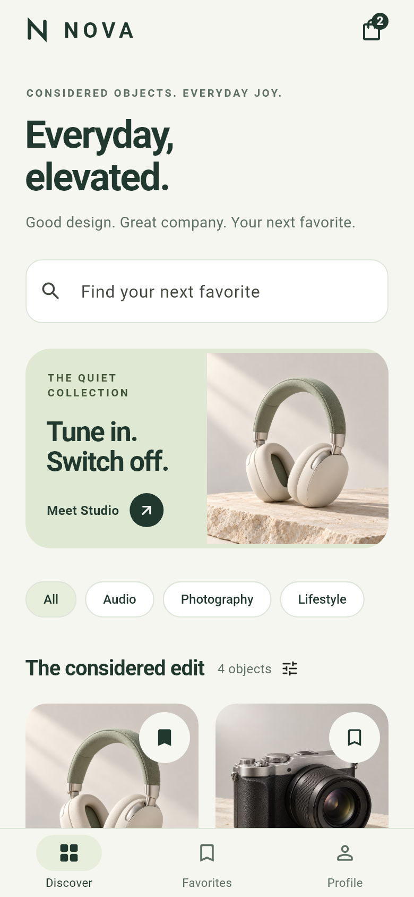
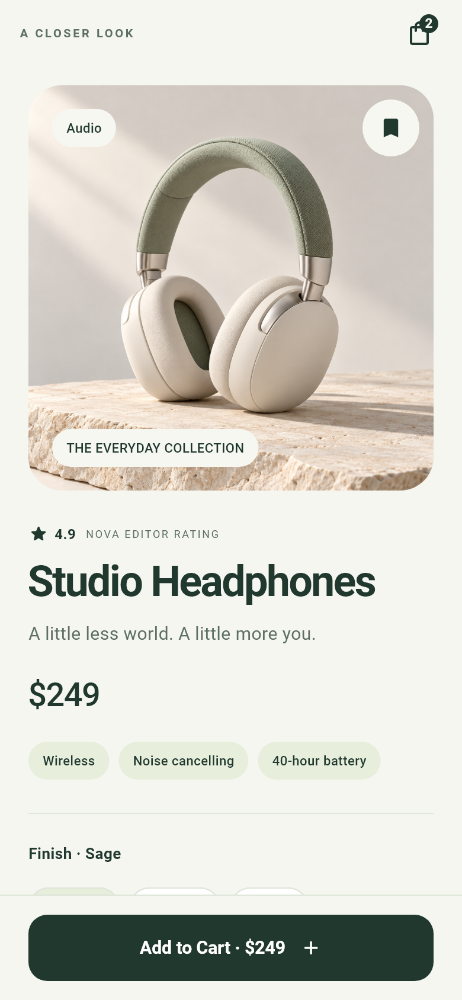
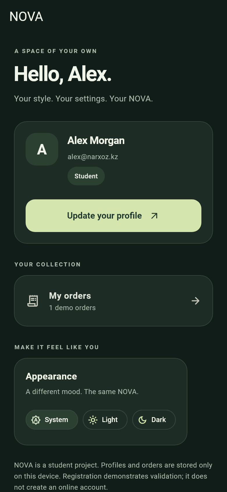
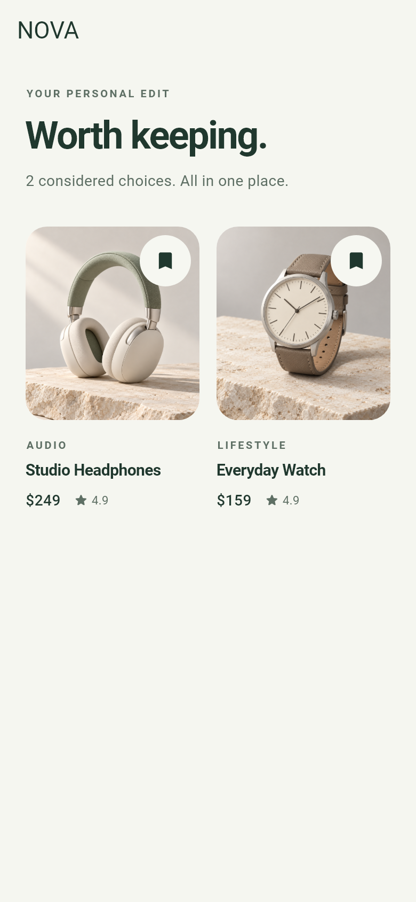
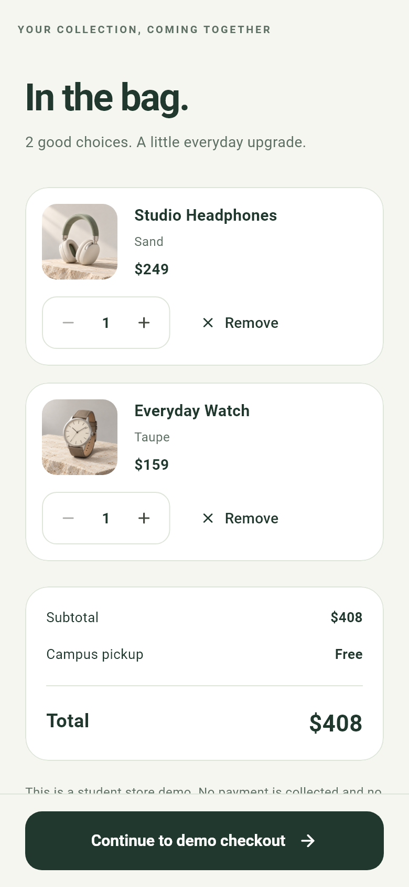
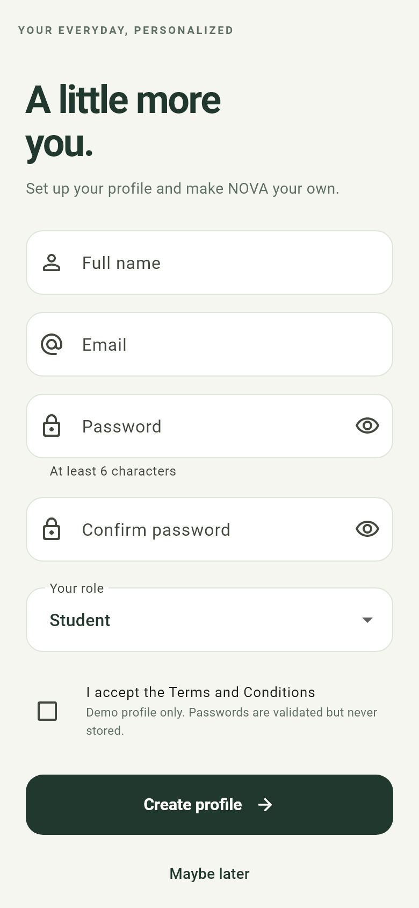

<div align="center">



# NOVA

### Everyday, elevated.

Минималистичный магазин техники на Flutter · Лабораторные 5, 6 и 7

[Видео демонстрации](Demo/nova-walkthrough.mp4) · [Основной код](lib/main.dart) · [Сценарий защиты](docs/DEFENSE.md)

</div>

---

NOVA помогает выбрать товар, изучить характеристики, сохранить избранное и оформить демо-заказ. Тёплые нейтральные оттенки, зелёные акценты, крупная типографика и плавные анимации объединяют все экраны. Приложение работает с локальными данными и не требует API-ключей.

## Интерфейс

| Каталог | Карточка товара | Тёмная тема |
| :---: | :---: | :---: |
|  |  |  |

| Избранное | Корзина | Регистрация |
| :---: | :---: | :---: |
|  |  |  |

Все изображения находятся в [Screenshots](Screenshots). Файлы `emulator-*` сняты в работающем Android-приложении; остальные — реальные Flutter-рендеры тестовых состояний, включая увеличенный текст и широкий экран.

## Видео демонстрации

**[Открыть запись экрана — MP4](Demo/nova-walkthrough.mp4)**

Каталог → товар → избранное → Add to Cart → возврат → Favorites → Profile.

Запись сделана на Android-эмуляторе, разрешение 720 × 1600. Если GitHub не показывает встроенный проигрыватель, скачайте файл через **View raw / Download**.

## Выполнение заданий

| Задание | Требование | Реализация |
| --- | --- | --- |
| **Lab 5** | Обложка с наложением | `Stack`: изображение товара, категория и bookmark |
| | Компоновка | `Row` для цены и рейтинга, `Wrap` для тегов и вариантов |
| | Закреплённая кнопка | Нижняя панель с `SafeArea` и кнопкой Add to Cart через `Expanded` |
| | Адаптивность | Прокрутка, перенос элементов, широкая и узкая компоновка |
| **Lab 6** | Регистрация | `Form`, `GlobalKey<FormState>`, `TextFormField`, `TextEditingController` |
| | Валидация | Имя, email с `@` и `.`, пароль от 6 символов, совпадение паролей |
| | Интерактивные элементы | Обязательное согласие с условиями и выбор роли |
| | Отправка | Проверка при вводе и отправке, ошибки под полями, `SnackBar`, debug-лог без пароля |
| **Lab 7** | Три вкладки | `BottomNavigationBar`: Discover (Feed), Favorites, Profile |
| | Каталог | Четыре товара с изображениями, названиями и ценами |
| | Передача данных | `Navigator.push` передаёт полный объект `Product` в `DetailScreen` |
| | Возврат | `Navigator.pop` через AppBar и кнопку внутри страницы |
| | Сохранение состояния | Общий `AppStore` и `IndexedStack`; избранное и корзина сохраняются локально |

Все классы приложения находятся в **[lib/main.dart](lib/main.dart)** — единый файл для объединённой сдачи лабораторных. Для отдельного требования Capstone о `lib/screens` и `lib/widgets` потребуется последующее разделение этих классов по папкам.

## Возможности

- Онбординг из трёх экранов, поиск, категории и сортировка товаров.
- Выбор варианта и количества, ограничения остатков, точный расчёт суммы в целых центах.
- Корзина, демо-оформление заказа, чек и история заказов.
- Локальный профиль, сохранение избранного, корзины, заказов и темы через `shared_preferences`.
- Светлая, тёмная и системная темы.
- `Hero`-переходы, появление экранов, анимации bookmark и кнопок, тактильный отклик.
- Поддержка системной настройки уменьшения анимаций и увеличенного текста.

Это учебный офлайн-MVP: регистрация не создаёт аккаунт на сервере, пароль не сохраняется и не выводится в лог. Оформление заказа не списывает деньги и не создаёт реальную доставку. Характеристики, рейтинг и остатки — демонстрационные данные.

## Запуск

Проверенная среда: **Flutter 3.47.6 / Dart 3.13.5**, Windows и Android SDK. Ограничение Dart указано в `pubspec.yaml`.

```bash
git clone https://github.com/Makhkam11-good/LAB7.git
cd LAB7
flutter pub get
flutter devices
flutter run
```

Перед `flutter run` запустите эмулятор через Android Studio → Device Manager или подключите телефон с USB debugging. Если устройств несколько, используйте `flutter run -d <device-id>`.

На Windows при сообщении о symlink support включите **Developer Mode** и повторите `flutter pub get`.

Для iOS нужны **macOS и Xcode**. iOS-проект и иконки включены, но сборка и подпись iOS на Windows не проверялись.

## Структура проекта

```text
lib/main.dart            Дизайн, модели, состояние, экраны и формы
assets/images/          Четыре изображения товаров, доступные офлайн
assets/fonts/           Roboto и лицензия шрифта
test/widget_test.dart   Проверки логики, сценариев и адаптивности
test/demo_capture_test.dart  Экспорт скриншотов и иконок
Screenshots/            Темы, крупный текст, Android-снимки
Demo/                   Видео переходов между экранами
docs/                   Дизайн-система, ресурсы, защита
android/ · ios/         Мобильные платформенные проекты
```

Внутри `main.dart` выделены логические разделы: дизайн-система → модели → репозиторий и `AppStore` → общие виджеты → экраны. `PreferencesRepository` хранит данные на устройстве, `MemoryRepository` изолирует тесты. Локальная интерактивность реализована через `StatefulWidget` и `setState()`.

## Проверка качества

```bash
flutter analyze
flutter test
flutter build apk --debug
```

Для повторного экспорта скриншотов:

```bash
flutter test test/demo_capture_test.dart --dart-define=CAPTURE=true
```

Основной набор содержит **18 тестов**: фильтрация и сортировка, остатки, суммы, сохранение и восстановление, обработка ошибок хранилища, навигация с передачей объекта, два способа возврата, регистрация и оформление заказа.

Проверки адаптивности охватывают 11 экранов при размерах **280×568, 320×568, 390×844, 640×360, 768×1024 и 1440×900**, обычном и удвоенном размере текста. Проверяются также ошибки формы с открытой клавиатурой и закрепление нижней кнопки при прокрутке. В проверенной матрице RenderFlex overflow не обнаружен.

APK после сборки: `build/app/outputs/flutter-apk/app-debug.apk`. Каталог `build/` исключён из Git.

## Материалы для защиты

- [Сценарий выступления на 3–5 минут](docs/DEFENSE.md)
- [Дизайн-система и анимации](docs/DESIGN.md)
- [Источники изображений, иконки и лицензия шрифта](docs/ASSETS.md)
- [Этапы реализации и проверки](docs/PROGRESS.md)

Изображения вымышленных товаров созданы для NOVA с помощью генерации изображений. Монограмма нарисована Flutter Canvas. REST API, база данных, серверная авторизация и BLoC — направления следующих этапов Capstone.
